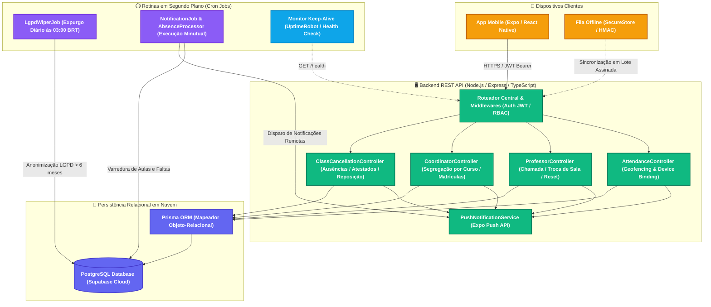

# 📍 GeoClass - Análise Técnica Detalhada do Projeto

Esta documentação apresenta a análise arquitetural, técnica, funcional e de conformidade de segurança do ecossistema **GeoClass**, contemplando a infraestrutura completa, os módulos de software, as regras de negócio e os fluxos de integração implementados.

---

## 🏗️ 1. Arquitetura Geral do Sistema

O **GeoClass** adota uma arquitetura distribuída cliente-servidor orientada a serviços REST, utilizando **TypeScript** de ponta a ponta para garantir tipagem estrita, consistência de dados e facilidade de manutenção.

### Tecnologias e Camadas
1. **Frontend Móvel Multiplataforma**: Desenvolvido em **React Native** com **Expo SDK 52** e TypeScript. Oferece suporte completo para Android e iOS a partir de código unificado, além de modo de execução e testes em navegadores Web com fallbacks automáticos para sensores.
2. **Backend API REST**: Desenvolvido em **Node.js** com **Express** e TypeScript, modularizado em camadas de rotas, controladores, serviços utilitários de data e jobs agendados.
3. **Persistência de Dados**: **PostgreSQL** hospedado na nuvem via **Supabase**, utilizando o **Prisma ORM** para abstração de schema, migrações e garantia de integridade relacional.
4. **Comunicação em Tempo Real / Notificações**: Integração com a **Expo Push API** para notificações proativas nativas nos dispositivos dos estudantes e docentes.

---

## 💾 2. Modelagem do Banco de Dados Relacional

O banco de dados relacional é composto por **12 entidades** rigorosamente normalizadas com integridade referencial:

| Tabela | Responsabilidade Arquitetural | Chaves e Restrições Notáveis |
| :--- | :--- | :--- |
| **`User`** | Armazena os usuários de todos os perfis (`STUDENT`, `TEACHER`, `COORDINATOR`), credenciais criptografadas (`bcryptjs`), `ra`, `push_token` e data do aceite LGPD. | `email` único, `ra` único para estudantes. |
| **`Course`** | Cadastra os cursos acadêmicos ofertados pela instituição (ex: Análise e Desenvolvimento de Sistemas, Comércio Exterior, Gestão Empresarial). | `code` único (ex: "ADS"). |
| **`UserCourse`** | Entidade associativa que vincula alunos e coordenadores aos seus cursos, permitindo a segregação departamental e rastreamento de conclusão (`is_completed`). | `@@unique([user_id, course_id])`. |
| **`Room`** | Cadastro da infraestrutura física do campus (salas e laboratórios) com coordenadas geográficas de centróide (`latitude`, `longitude`) e raio de tolerância. | `name` único. |
| **`AcademicSemester`** | Identifica os períodos letivos da faculdade (ex: "2026.1"), contendo datas oficiais de início e término. | `code` único. |
| **`AcademicCalendar`** | Cadastra dias não letivos, feriados, recessos acadêmicos, semanas de provas (SPAP) e exames, suspendendo a exigência de chamada nessas datas. | `date` indexada com enum `EventType`. |
| **`Class`** | Representa as disciplinas/turmas ofertadas em determinado semestre, professor responsável, sala de aula padrão e grade horária de slots (`schedule_time`). | FKs para `User` (Professor), `Room`, `Course` e `AcademicSemester`. |
| **`Enrollment`** | Matrícula formal do estudante na disciplina em um semestre letivo, com flag de conclusão individual da matéria (`is_completed`). | `@@unique([student_id, class_id])`. |
| **`Attendance`** | Registros de frequência diários por aluno e slot de aula. Armazena `status` (`PRESENTE`, `ATRASADO`, `FALTA`, `PRESENCA_PARCIAL`), coordenadas GPS, `device_id` e flags de contingência (`is_remote`, `manual_attendance`). | `@@unique([student_id, class_id, date, slot_time])`. |
| **`TemporaryClassLocation`** | Realocações temporárias de sala realizadas por professores para datas específicas, substituindo a geolocalização padrão da disciplina. | FKs para `Class` e `Room`. |
| **`Notification`** | Histórico de notificações no aplicativo (*in-app notifications*) com títulos, mensagens e controle de leitura. | FK para `User` com indexação por destinatário. |
| **`ClassCancellation`** | Gestão de ausências docentes, solicitações de falta com anexo de atestado comprobatório, suspensões institucionais diretas pela coordenação e agendamento de reposições de aula. | FKs para `Class`, `User` (Professor) e `User` (Coordenador aprovador). |

---

## 🔒 3. Mecanismos Centrais de Segurança e Regras de Negócio

### A. Geofencing Server-Side com Compensação de Acurácia (Fórmula de Haversine)
A validação de proximidade física é realizada **exclusivamente no servidor** para mitigar ataques baseados em dispositivos modificados (*root/jailbreak*) ou aplicações de simulação de coordenadas (*Fake GPS*):
1. O aplicativo cliente solicita leitura de alta precisão ao sistema operacional (`Location.Accuracy.High`).
2. O servidor consulta as coordenadas cadastradas para a sala da disciplina (priorizando a sala temporária de `TemporaryClassLocation` caso haja realocação no dia).
3. A distância euclidiana esférica é calculada via Fórmula de Haversine:
   $$d = 2R \cdot \arcsin\left(\sqrt{\sin^2\left(\frac{\Delta\phi}{2}\right) + \cos(\phi_1)\cos(\phi_2)\sin^2\left(\frac{\Delta\lambda}{2}\right)}\right)$$
4. O servidor aplica a compensação da incerteza do sinal do sensor (`accuracy`), aceitando a presença se:
   $$\text{distância} - \text{gpsAccuracy} \le \text{radius\_meters}$$

### B. Gestão Canônica de Fuso Horário e Múltiplos Slots de Aula
- O sistema opera padronizado no **Fuso Horário Oficial de Brasília (`America/Sao_Paulo` / UTC-3)** através do utilitário `dateUtils.ts`.
- Disciplinas com múltiplos horários em dias distintos da semana (ex: Terça das 19:00 às 20:40 e Quarta das 20:50 às 22:30) têm seus horários decompostos em **slots independentes de 50 minutos** (`scheduleHelper.ts`).
- Para campos de data pura do PostgreSQL (`@db.Date`), o sistema utiliza a função canônica `isMidnightUtcDate` para evitar retrocessos involuntários de um dia decorrentes da subtração de 3 horas em conversões de timezone locais.

### C. Bloqueio Antifraude por Vínculo de Hardware (*Device Binding*)
- No momento do check-in, o aplicativo extrai um identificador de hardware único do aparelho (`Application.getAndroidId()` ou `Application.getIosIdForVendorAsync()`).
- O servidor valida se aquele identificador físico já foi registrado no mesmo dia para outro estudante.
- Caso outro aluno tente registrar presença utilizando o mesmo celular, a requisição é terminada com erro `403 Forbidden` ("Dispositivo já utilizado por outro aluno nesta data").
- O professor e o coordenador dispõem do recurso `resetDeviceBinding` para liberar o identificador em casos justificados de substituição de aparelho.

### D. Fila Offline Resiliente com Assinatura Criptográfica HMAC SHA-256
- Em caso de falha de conexão na sala de aula, o aplicativo valida as coordenadas localmente e gera um pacote assinado:
  $$\text{HMAC-SHA256}(\text{timestamp} + \text{deviceId} + \text{classId}, \text{OFFLINE\_SECRET})$$
- O pacote é armazenado com segurança local no dispositivo (`SecureStore`).
- Ao restabelecer a conectividade de rede, o hook `useOfflineQueue.ts` submete a fila para o backend.
- O servidor recalcula o hash criptográfico com a chave secreta compartilhada; se a assinatura for válida e a batida tiver ocorrido dentro da tolerância oficial do slot, o registro é homologado retroativamente.

### E. Segregação Departamental da Coordenação por Curso
- Coordenadores possuem seus acessos delimitados aos cursos aos quais estão vinculados (`UserCourse`).
- Todas as consultas gerenciais (semestres, turmas ativas, lista de estudantes matriculados e alunos em risco de evasão) aplicam o filtro `course_id: { in: coordinatorCourseIds }`.
- Impede que o coordenador de um curso (ex: ADS) visualize ou manipule informações de turmas ou estudantes de outros cursos (ex: Comércio Exterior ou Gestão Empresarial).

### F. Suspensão de Aulas, Atestados e Reposição com Presença Parcial
- Quando uma aula é suspensa por ausência justificada do docente ou determinação da coordenação, os estudantes matriculados recebem o status provisório `PRESENCA_PARCIAL`.
- O docente comunica a falta utilizando o botão com confirmação de pressão contínua de 1 segundo (`HoldButton`), podendo anexar atestado médico comprobatório (PDF ou Imagem base64).
- A reposição é agendada e sinalizada no calendário acadêmico na cor âmbar. Na data da reposição, o professor realiza a chamada através de checkboxes pré-selecionados, convertendo as presenças parciais em presenças definitivas (`PRESENTE` ou `FALTA`).

---

## ⚖️ 4. Governança e Privacidade (Conformidade com a LGPD)

Em obediência à **Lei Geral de Proteção de Dados Pessoais (Lei nº 13.709/2018)**, o GeoClass aplica os princípios fundamentais de *Privacy by Design* e *Data Minimization*:

1. **Consentimento Explícito (Art. 7º, I)**: No primeiro acesso do aluno, a tela de privacidade apresenta termos detalhados sobre o tratamento das coordenadas geográficas e identificador de aparelho. O acesso às funcionalidades de presença só é liberado após o aceite explícito, registrado em banco com data e hora (`privacy_terms_accepted_at`).
2. **Expurgo Periódico de Dados Sensíveis (`LgpdWiperJob`)**:
   - Um serviço em segundo plano roda diariamente às 03:00 AM (horário de Brasília).
   - Registros de presença na tabela `Attendance` com data superior a **6 meses** têm suas coordenadas geográficas (`student_latitude`, `student_longitude`) e o identificador do aparelho (`device_id`) permanentemente sobrescritos como `NULL`.
   - O status acadêmico da presença (`PRESENTE`, `ATRASADO`, `FALTA`) é mantido de forma perpétua, garantindo o histórico escolar do estudante sem reter dados biométricos/rastreáveis além do período legal de finalidade.

---

## 📬 5. Rotinas Automatizadas em Segundo Plano (Background Jobs)

| Job / Serviço | Frequência de Execução | Descrição Operacional |
| :--- | :--- | :--- |
| **`LgpdWiperJob`** | Diário às 03:00 AM (BRT) | Anonimiza coordenadas GPS e `device_id` de presenças com mais de 6 meses de antiguidade. |
| **`NotificationJob`** | A cada 1 minuto | Varre a grade de aulas do dia corrente: dispara lembretes de início de aula aos alunos, alerta o fim da janela de tolerância de 15 minutos e envia resumo diário ao professor. |
| **`AbsenceProcessor`** | A cada 1 minuto e on-demand | Identifica alunos sem registro de presença após os 15 minutos de tolerância e lança automaticamente o status `FALTA` no banco de dados. Executa auto-remediação removendo faltas indevidas prematuras em slots ainda não iniciados. |
| **`PushNotificationService`**| Em tempo real / eventos | Conecta à Expo Push API para despachar alertas de suspensão de aulas, agendamento de reposição, cobrança de atestados e avisos de risco de reprovação (< 75%). |
| **Keep-Alive Pinger** | A cada 5 minutos | Serviço externo que efetua chamadas `GET /health` impedindo que a instância do Web Service entre em hibernação (*cold-start*). |

---

## 📂 6. Estrutura dos Módulos do Sistema

### Backend (`geoclass-api/`)
- `prisma/schema.prisma`: Definição declarativa das 12 entidades relacionais, enums e índices.
- `src/server.ts`: Inicialização da aplicação Express, middlewares de segurança e inicialização dos cron jobs.
- `src/routes/index.ts`: Mapeamento centralizado de rotas públicas e protegidas por perfil (Aluno, Professor, Coordenador).
- `src/controllers/`:
  - `AuthController.ts`: Autenticação JWT, controle de perfis RBAC e registro de aceite dos termos LGPD.
  - `AttendanceController.ts`: Processamento de presença via Geofencing, device binding e sincronização offline.
  - `ProfessorController.ts`: Chamada manual, realocação de sala e gestão de presença por disciplina.
  - `CoordinatorController.ts`: Gestão multi-curso, virada de semestre, infraestrutura de salas e acompanhamento de evasão.
  - `ClassCancellationController.ts`: Ausências docentes, anexo de atestados, cancelamento institucional e reposições.
- `src/services/pushNotificationService.ts`: Despacho de mensagens push via Expo Push API.
- `src/jobs/`:
  - `LgpdWiperJob.ts`: Rotina de expurgo de geodados legados.
  - `NotificationJob.ts`: Orquestrador minutual de notificações e fechamento de ausências.
  - `AbsenceProcessor.ts`: Motor de cômputo e auto-remediação de faltas escolares.
- `src/utils/`:
  - `dateUtils.ts`: Tratamento canônico de datas e fuso de Brasília (`America/Sao_Paulo`).
  - `scheduleHelper.ts`: Decomposição e resolução de slots diários de aula por dia da semana.

### Frontend (`geoclass-mobile/`)
- `src/navigation/`: Navegação nativa hierárquica baseada nos perfis de Aluno, Professor e Coordenador.
- `src/screens/`:
  - `auth/LoginScreen.tsx` e `PrivacyScreen.tsx`: Login e aceite de privacidade.
  - `student/HomeScreen.tsx` e `HistoryScreen.tsx`: Consulta de grade diária, check-in por GPS e histórico acadêmico.
  - `teacher/ProfessorClassesScreen.tsx` e `ManualAttendanceScreen.tsx`: Gestão de chamadas e turmas docentes.
  - `coordinator/CoordinatorDashboardScreen.tsx` e `SemestersScreen.tsx`: Painel de controle e monitoramento acadêmico.
- `src/hooks/`:
  - `useStudentHome.ts`: Orquestração de presença, permissões de GPS e validação de fake GPS.
  - `useOfflineQueue.ts`: Enfileiramento e sincronização de pacotes criptografados offline.
  - `useNotifications.ts`: Central de notificações e badges de alertas não lidos.
- `src/components/`: Componentes visuais reutilizáveis, incluindo `HoldButton.tsx` para ações críticas intencionais.

---

## 🚀 7. Considerações Finais

O projeto **GeoClass** atinge maturidade técnica alinhada com as melhores práticas de Engenharia de Software:
- **Separação de Responsabilidades:** Camadas desacopladas com forte coesão e baixo acoplamento.
- **Rastreabilidade Completa:** Cada regra institucional e necessidade de usuário possui cobertura direta de requisitos, casos de uso, rotas e tabelas.
- **Segurança Pró-Ativa:** Geofencing server-side, integridade de hardware com Device Binding, criptografia em repouso e em trânsito, e conformidade rigorosa com a legislação de dados pessoais (LGPD).
