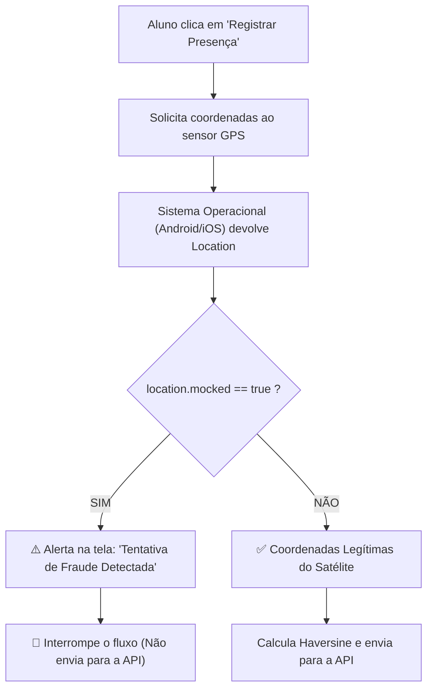

# 🛡️ Mecanismo de Detecção de Fake GPS no GeoClass

Este documento explica de forma detalhada, intuitiva e técnica como o **GeoClass** detecta e bloqueia tentativas de fraude por meio de aplicativos de localização fictícia (**Fake GPS**).

---

## 1. O que é o "Fake GPS"?

Em um smartphone comum, a posição geográfica é determinada por um receptor de hardware que se conecta a satélites (GPS, GLONASS, Galileo) e triangula antenas de celular e redes Wi-Fi.

No entanto, tanto o **Android** quanto o **iOS** possuem recursos originalmente voltados para desenvolvedores testarem aplicativos (por exemplo, testar como um app de corrida se comporta em Nova York estando no Brasil). 

Para burlar sistemas de presença baseados em geolocalização, alguns usuários instalam aplicativos de **Localização Simulada** (*Mock Locations*), como o *"Fake GPS Location"*:
1. O aluno ativa as **"Opções do Desenvolvedor"** nas configurações do Android.
2. Define o aplicativo de Fake GPS como o **"App de local fictício"** do aparelho.
3. O aplicativo de Fake GPS passa a injetar coordenadas falsas (por exemplo, as coordenadas da sala de aula da faculdade) no sistema operacional, mesmo com o aluno deitado em casa.

---

## 2. Como o GeoClass Detecta a Fraude?

O GeoClass implementa a detecção em tempo de execução diretamente na captura de sinal do sensor, **antes mesmo de enviar qualquer dado para a API**.

### Diagrama do Fluxo de Detecção



---

## 3. As Camadas Técnicas da Detecção

A detecção ocorre em três níveis integrados:

### Nível 1: O Sistema Operacional (Android / iOS)
Quando um aplicativo injeta uma coordenada falsa, o sistema operacional Android sinaliza internamente essa origem através da API nativa:
- Método nativo Android: `location.isFromMockProvider()` (ou `isMock()` a partir do Android 12 / API 31).
- O sistema operacional sabe que aquela coordenada não veio do chipset de satélite de hardware, mas sim de um software de terceiros.

### Nível 2: A Camada de Abstração (`expo-location`)
O GeoClass utiliza o módulo [`expo-location`](https://docs.expo.dev/versions/latest/sdk/location/) para comunicação com o subsistema de localização.
Ao chamar `Location.getCurrentPositionAsync()`, o módulo lê a flag nativa do sistema operacional e a expõe na propriedade:
```typescript
location.mocked: boolean
```
- `false`: a coordenada veio dos satélites/antenas reais de hardware.
- `true`: a coordenada foi forjada por um aplicativo de local fictício.

### Nível 3: A Validação no Código do GeoClass
No hook de presença do aluno ([`geoclass-mobile/src/hooks/useStudentHome.ts`](file:///home/lais/projetos/geoclass/geoclass-mobile/src/hooks/useStudentHome.ts#L106-L122)), a verificação é realizada no exato instante da captura:

```typescript
// 1. Captura da localização com alta precisão
const location = await Location.getCurrentPositionAsync({
  accuracy: Location.Accuracy.High,
});

lat = location.coords.latitude;
lon = location.coords.longitude;
accuracy = location.coords.accuracy ?? undefined;

// 2. Verificação de Fraude de Localização Fictícia
if (location.mocked === true) {
  Alert.alert(
    'Tentativa de Fraude Detectada',
    'O uso de aplicativos de localização fictícia (Fake GPS) é estritamente proibido pelo regulamento acadêmico.'
  );
  setProcessingId(null);
  return; // O fluxo é encerrado imediatamente!
}
```

---

## 4. O que acontece quando o aluno tenta usar o Fake GPS?

1. **Bloqueio Imediato no Celular:**  
   Assim que o aluno clica em "Registrar Presença" com o Fake GPS ativado, a propriedade `location.mocked` é identificada como `true`.
2. **Nenhum Dado é Enviado ao Servidor:**  
   O aplicativo **não** faz a chamada `POST /aluno/presenca`. Isso impede o desperdício de banda e previne o registro indevido.
3. **Alerta Educativo/Disciplinar:**  
   O aluno recebe um pop-up na tela com o aviso:
   > ⚠️ **Tentativa de Fraude Detectada**  
   > *O uso de aplicativos de localização fictícia (Fake GPS) é estritamente proibido pelo regulamento acadêmico.*
4. **Proteção no Modo Offline:**  
   Caso o aluno desligue a internet na tentativa de salvar um pacote offline fraudado, a checagem é executada da mesma forma no início da função, impedindo também a gravação na fila offline do aparelho.

---

## 5. Segurança em Camadas (Defense in Depth)

A detecção de Fake GPS é parte de uma arquitetura de segurança multicamadas implementada no GeoClass:

| Camada de Segurança | Mecanismo | O que previne |
| :--- | :--- | :--- |
| **1. Anti-Fake GPS** | Flag `location.mocked` | Aluno forjar estar na faculdade quando está em outro local. |
| **2. Geofencing** | Fórmula de Haversine ($d \le R$) | Aluno tentar registrar presença estando fora da sala ou no campus sem ir à aula. |
| **3. Anti-Proxy (Amigo)** | Vínculo de `device_id` único no dia | Um mesmo celular bater presença para múltiplos colegas ausentes. |
| **4. Janela Temporal** | Validação de Slots de Horário na API | Registro de presenças retroativas ou fora do horário letivo. |
| **5. Anti-Adulteração Offline** | Assinatura Criptográfica SHA-256 | Aluno tentar editar manualmente o arquivo local com coordenadas ou horários forjados antes da sincronização. |

---

## 6. Considerações Acadêmicas (Para o TCC / Artigo)

No seu trabalho acadêmico, você pode destacar estes pontos na seção de **Segurança e Confiabilidade**:

1. **Zero Falso Positivo para Usuários Convencionais:**  
   A flag `isMock` só se torna `true` se o usuário ativamente habilitar as Opções de Desenvolvedor no Android e associar um aplicativo de simulação. Usuários em condições normais de uso do GPS físico nunca são bloqueados por esse critério.
2. **Custo Computacional Quase Nulo:**  
   A verificação é uma checagem booleana em memória (`O(1)`), não demandando consultas extras ao banco de dados nem chamadas de rede.
3. **Trabalhos Futuros e Cenários de "Root":**  
   Em cenários extremos onde o usuário possui acesso *root* (via Magisk ou módulos de baixo nível que interceptam a chamada de sistema do kernel para ocultar a flag `mocked`), contramedidas avançadas complementares podem ser integradas no futuro, tais como a **Google Play Integrity API** (antigo SafetyNet) ou atestação de integridade de hardware (TEE / KeyStore).

