# Arquitetura Visual do Sistema GeoClass

Para apresentar a arquitetura de forma visual e profissional, você pode utilizar o **Mermaid**, que é uma linguagem de diagramação baseada em texto que gera gráficos automaticamente. O Mermaid é suportado nativamente pelo GitHub, Notion, Obsidian e várias outras plataformas.

Abaixo está o código do diagrama da arquitetura completa e atualizada do GeoClass, contemplando a migração para o **Cloudflare D1**, o **Motor de Fuso Horário de Brasília (UTC-3)**, o **Serviço de Push Notifications** e a **Auto-Remediação de Faltas**.

## Diagrama da Arquitetura

```mermaid
flowchart TD
    %% Estilização Personalizada
    classDef external fill:#ef4444,stroke:#dc2626,stroke-width:2px,color:#fff,font-weight:bold
    classDef client fill:#f59e0b,stroke:#b45309,stroke-width:2px,color:#fff,font-weight:bold
    classDef frontend fill:#3b82f6,stroke:#1d4ed8,stroke-width:2px,color:#fff,font-weight:bold
    classDef backend fill:#10b981,stroke:#047857,stroke-width:2px,color:#fff,font-weight:bold
    classDef database fill:#6366f1,stroke:#4338ca,stroke-width:2px,color:#fff,font-weight:bold
    classDef job fill:#8b5cf6,stroke:#6d28d9,stroke-width:2px,color:#fff,font-weight:bold

    subgraph External ["Serviços Externos de Infraestrutura"]
        UptimeRobot["⏰ UptimeRobot - Keep-Alive Pinger (5 min)"]:::external
        ExpoPush["🔔 Expo Push Notification Service"]:::external
    end

    subgraph Clients ["Dispositivos Clientes"]
        direction LR
        Mobile["📱 App Mobile Aluno / Prof / Coord (Android/iOS)"]:::client
        Web["💻 Navegador Web Admin / Coord"]:::client
    end

    subgraph Frontend ["Frontend Services - React Native / Expo"]
        direction TB
        UI["Interface de Telas & Badges"]:::frontend
        Device["Módulo Device ID Binding"]:::frontend
        GPS["Módulo de Geolocalização (Expo Location)"]:::frontend
        OfflineQ["Fila Offline & Assinatura SHA-256"]:::frontend
        ReadOnlyGuard["Guard Modo Leitura (Curso Concluído)"]:::frontend
        AbsenceModule["Módulo de Faltas, Atestados & Reposições"]:::frontend
        PushClient["Push Token Registrar (Expo Notifications)"]:::frontend
    end

    subgraph Backend ["Cloud Web Service - Render.com / Node.js Express"]
        direction TB
        Auth["Auth Service - JWT & Account Status"]:::backend
        TimeEngine["Motor de Fuso Horário & Slots (dateUtils - America/Sao_Paulo UTC-3)"]:::backend
        GeoEngine["Motor Geofencing - Haversine & Validação Multi-Slot"]:::backend
        StudentAPI["API do Aluno & Status Dinâmico por Slot"]:::backend
        ProfAPI["API do Professor"]:::backend
        CoordAPI["API do Coordenador & Batch Virada"]:::backend
        CancellationAPI["API de Cancelamentos, Atestados & Reposições"]:::backend
        NotifAPI["API de Notificações Internas & Push Service"]:::backend
        SemUtil["Utilitário de Semestre Automático (YYYY.1/2)"]:::backend
    end

    subgraph Background ["Jobs Agendados - node-cron & Processadores"]
        CronLGPD["LgpdWiperJob - 03:00 AM (Expurgo Diário)"]:::job
        AbsenceProc["AbsenceProcessor - Fechamento 15m & Auto-Remediação"]:::job
        CronNotif["NotificationJob - Início de Aula & Fechamento Professor"]:::job
        RiskJob["RiskCheckerJob - Notificação Auto de Risco (<75%)"]:::job
    end

    subgraph Persistence ["Edge Relational Database - Cloudflare D1"]
        direction TB
        Adapter["Prisma D1 Adapter (@prisma/adapter-d1)"]:::database
        ORM["Prisma ORM Client"]:::database
        DB[("Cloudflare D1 Database - Edge SQL Engine")]:::database
    end

    %% Keep-Alive
    UptimeRobot -->|GET /health a cada 5 min| Backend

    %% Push Notifications
    NotifAPI -->|Disparo via HTTP| ExpoPush
    ExpoPush -.->|Push Notification Remota| Mobile

    %% Interações Usuário -> Frontend
    Mobile -->|Interação| UI
    Web -->|Interação| UI

    %% Fluxos Internos do Frontend
    UI --> Device
    UI --> GPS
    UI --> OfflineQ
    UI --> ReadOnlyGuard
    UI --> AbsenceModule
    UI --> PushClient

    %% Comunicação Frontend -> Backend API
    UI -->|Login / Token JWT| Auth
    PushClient -->|Registra push_token do Aparelho| NotifAPI
    GPS -->|Coordenadas + Device ID + Slot| StudentAPI
    OfflineQ -->|Sync Pacotes Assinados| StudentAPI
    UI -->|Gestão de Chamada & Salas| ProfAPI
    UI -->|Dashboard, Risco & Virada| CoordAPI
    AbsenceModule -->|Avisos, Atestados, Suspensões & Reposições| CancellationAPI
    UI -->|Avisos & Notificações| NotifAPI

    %% Fluxos Internos do Backend
    StudentAPI -->|Normaliza Datas e Horários no Fuso BRT| TimeEngine
    StudentAPI -->|Valida Distância, Janela de 15m & IsCompleted| GeoEngine
    CoordAPI -->|Calcula YYYY.1/2 & Incrementa Semestres| SemUtil
    CancellationAPI -->|Dispara Alertas de Cancelamento/Reposição| NotifAPI
    Auth --> ORM
    StudentAPI --> ORM
    ProfAPI --> ORM
    CoordAPI --> ORM
    CancellationAPI --> ORM
    NotifAPI --> ORM

    %% Camada de Persistência com Cloudflare D1
    ORM --> Adapter
    Adapter -->|Cloudflare API / D1 Protocol| DB

    %% Jobs Background & Processamento Autônomo
    CronLGPD -.->|Expurgo Diário >6 meses| ORM
    AbsenceProc -.->|Valida Tolerância 15m no Fuso BRT & Remove Faltas Prematuras| ORM
    CronNotif -.->|Dispara AbsenceProc e Notifica Início/Fim de Slot| ORM
    RiskJob -.->|Monitora Frequência <75%| ORM
```



---

## Como usar este diagrama:

1. **Uso Imediato (Markdown):** Se você for colocar isso no README do GitHub do seu projeto, basta colar o bloco de código acima. O GitHub vai renderizar a imagem visualmente!
2. **Para Exportar como Imagem no [Mermaid Live Editor](https://mermaid.live):** 
   - ⚠️ **ATENÇÃO AO COPIAR:** No editor do Mermaid Live, **NÃO cole a primeira linha ```` ```mermaid ```` nem a última linha ```` ``` ````**.
   - Cole **apenas o conteúdo interno**, começando na palavra `flowchart TD` e indo até a última linha `RiskJob -.->|Monitora Frequência <75%| ORM`.
   - Clique em **"Save as PNG"** ou **"Save as SVG"** no canto inferior direito para baixar a imagem em alta qualidade e colocar no seu documento/apresentação.

## O que este diagrama demonstra (para explicar na sua apresentação):
- **Infraestrutura Serverless de Borda com Cloudflare D1:** Exibe a API hospedada no **Render.com** conectada ao banco de dados relacional distribuído **Cloudflare D1** através do **`@prisma/adapter-d1`**, garantindo alta velocidade de leitura, consistência transacional e baixa latência.
- **Motor de Fuso Horário e Tolerância Estrita (`dateUtils`):** Demonstra como o backend normaliza todos os horários e datas para o **Horário de Brasília (`America/Sao_Paulo`, UTC-3)**, eliminando conflitos de fuso causados por servidores em nuvem rodando em UTC e garantindo que janelas de tolerância de 15 minutos sejam avaliadas com exatidão civil.
- **Auto-Remediação de Ausências (`AbsenceProcessor`):** Processador autônomo que fecha chamadas expiradas gerando faltas para alunos ausentes e ao mesmo tempo identifica e remove registros prematuros para slots que ainda não haviam encerrado.
- **Serviço de Notificações Push (Expo Push API):** Integração para envio de avisos proativos nos smartphones de alunos e professores (lembretes no início do slot e relatório de presença no encerramento da tolerância de 15 minutos).
- **Prevenção de Cold-Start (Keep-Alive):** O **UptimeRobot** realiza pings automáticos a cada 5 minutos na rota `/health` para evitar que a API no Render entre em hibernação no plano gratuito.
- **Suporte Multi-Curso & Multi-Slot:** Valida o status do curso por aluno (`UserCourse`), impedindo chamadas para cursos concluídos (**Modo Leitura**) e gerenciando múltiplos blocos de horário por dia (`slot_time`).
- **Resiliência Offline:** O módulo da **Fila Offline com Assinatura Criptográfica SHA-256** garante que chamadas registradas sem internet sejam enviadas com segurança assim que a conexão for estabelecida.
- **Segurança & Antifraude no Backend:** Mostra como o `Device ID` e o `Motor Geofencing` (Haversine + Janela estrita de 15 minutos) são validados diretamente no servidor.
- **Gestão Automática de Semestres e Risco:** Demonstra o utilitário de identificação automática de semestre letivo (`YYYY.1`/`YYYY.2`), o motor de **Virada de Semestre em Lote** e os alertas proativos automáticos para alunos com frequência crítica (`< 75%`).
- **Privacidade & Compliance LGPD:** Demonstra as rotinas agendadas `LgpdWiperJob` (expurgo de geodados antigos) e `NotificationJob` operando em segundo plano.
