# Fluxos de Utilização (User Journeys) - GeoClass

Este documento mapeia detalhadamente o passo a passo de todas as interações de cada perfil de usuário (**Aluno**, **Professor**, **Coordenador**) e das rotinas autônomas de **Infraestrutura** no ecossistema **GeoClass**.

Para ilustrar o caminho de ponta a ponta (desde a ação da interface móvel/web até a resposta e persistência no banco de dados), utilizam-se **Diagramas de Sequência (UML)** na notação **Mermaid**.

---

## 1. Fluxos do Aluno

O perfil de Aluno engloba o ciclo completo desde a autenticação com aceite dos termos da LGPD, passando pelo registro de presença via GPS (online/offline), até a consulta de histórico acadêmico e alertas.

### 1.1 Autenticação, Consentimento LGPD & Consulta de Aulas do Dia
O aluno realiza a autenticação por e-mail/senha, valida o aceite dos termos de privacidade e visualiza a grade de aulas marcadas para o dia corrente.

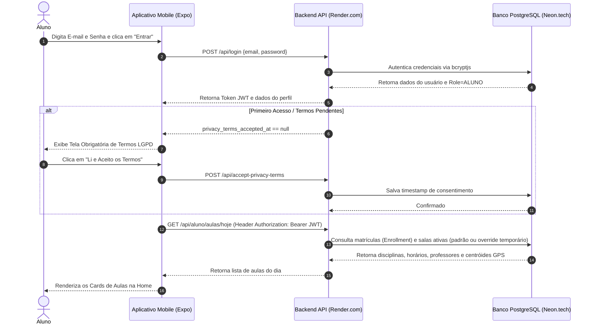

---

### 1.2 Registro de Presença com Geofencing & Antifraude (Online)
Fluxo principal de check-in onde a API valida a localização por Haversine, a janela estrita de 15 minutos e a colisão de ID do hardware.

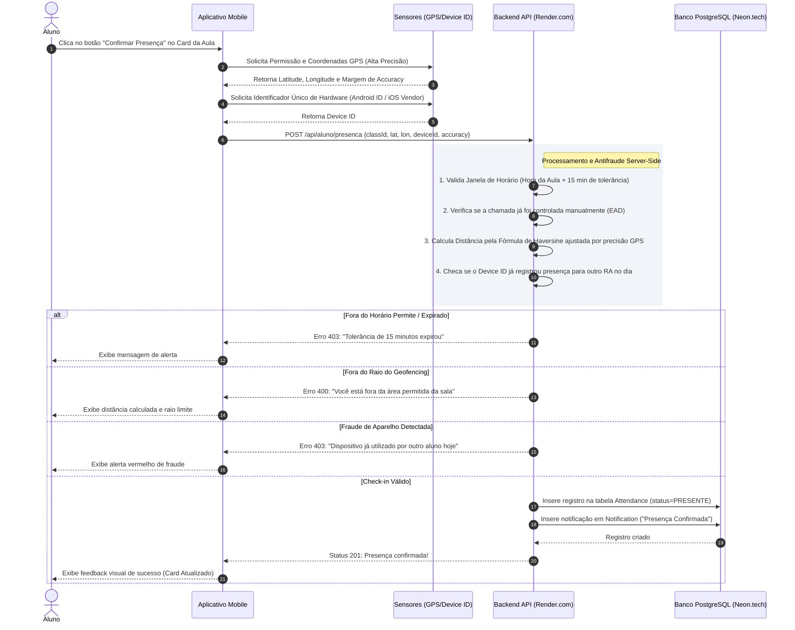

---

### 1.3 Fila Offline Criptografada (SHA-256) & Sincronização Automática
Garante a resiliência do registro quando o aluno estiver sem conexão de internet no momento da chamada.

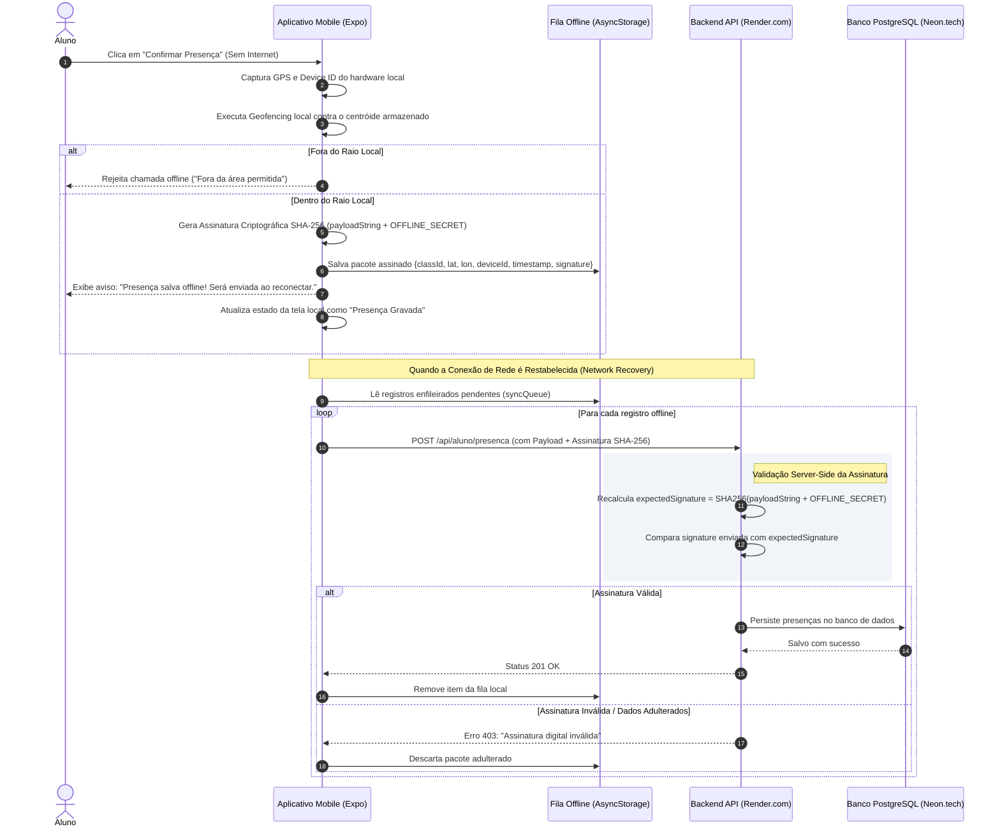

---

### 1.4 Dashboard de Frequência, Histórico Acadêmico & Notificações
Permite ao aluno acompanhar seu percentual de frequência por matéria, consultar seu histórico de chamadas e visualizar notificações.

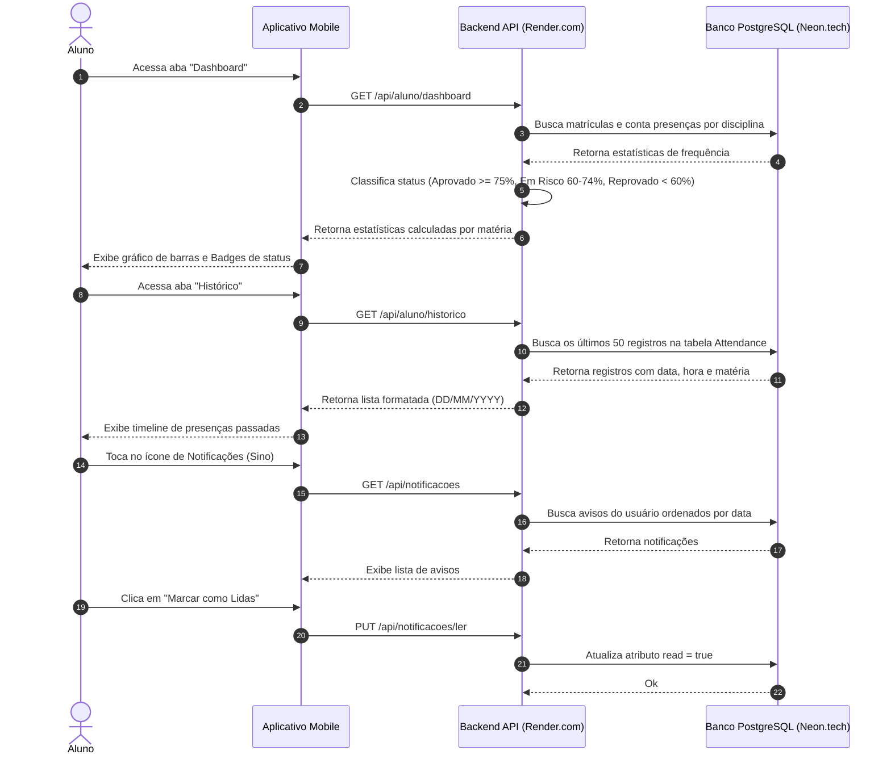

---

## 2. Fluxos do Professor

O perfil de Professor possui autonomia operacional para gerenciar suas turmas no dia a dia acadêmico através de 4 fluxos principais:

### 2.1 Acompanhamento de Turmas & Chamada em Tempo Real
O professor visualiza as turmas do dia e monitora os alunos que efetuam check-in via GPS em tempo real.

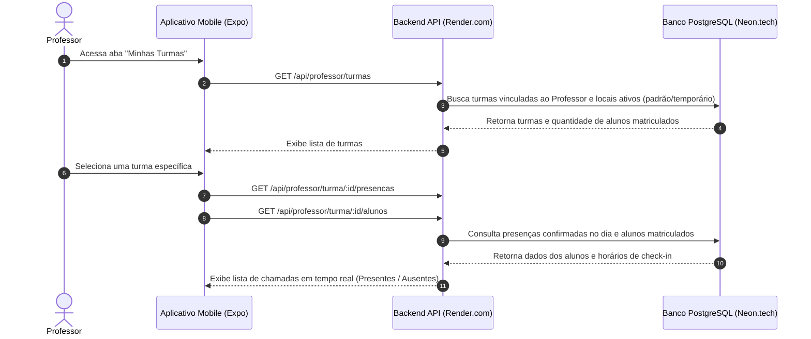

---

### 2.2 Troca Temporária de Sala & Notificação em Tempo Real
Permite ao professor alterar a sala de aula dinamicamente (ex: ida a um laboratório). O sistema realiza dupla verificação de conflitos de agenda e notifica todos os alunos matriculados.

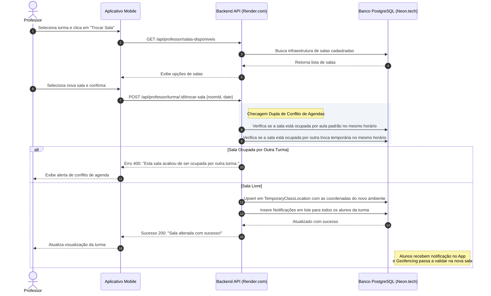

---

### 2.3 Chamada Manual & Lançamento de Aula Remota (EAD)
Permite o lançamento de presença/falta para aulas ministradas à distância ou em situações onde a chamada por GPS é dispensada pelo docente.

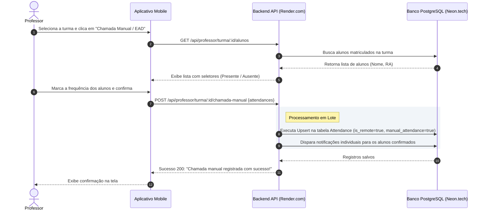

---

### 2.4 Reset de Vínculo de Dispositivo (Device Binding Reset)
Permite ao professor desvincular o `Device ID` de um aluno em caso de troca de aparelho ou imprevisto tecnológico durante a aula.

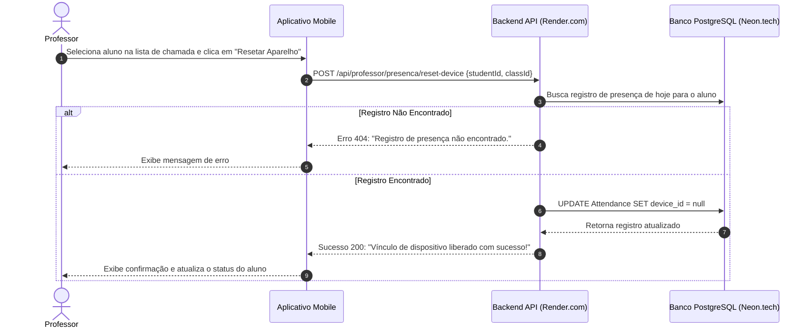

---

### 2.5 Solicitação de Falta & Anexo de Atestado Médico pelo Professor
O professor comunica ausência antecipada ou imprevista pelo botão "Avisar Falta", seleciona o motivo e pode anexar atestado imediatamente ou posteriormente pela aba "Atestados / Minhas Faltas".

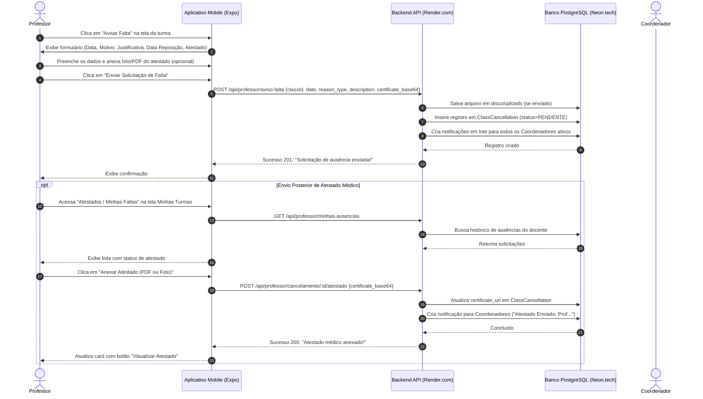

---

### 2.6 Agendamento de Aula de Reposição & Notificação Automática
Permite ao professor (ou coordenador) definir ou alterar a data de reposição para qualquer ausência aprovada, vinculando-a à aula sem aula e notificando automaticamente todos os alunos e docentes.

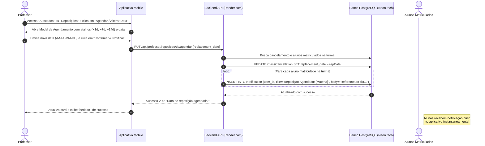

---

### 2.7 Chamada de Aula de Reposição & Conversão de Presença Parcial
Na data da reposição, o docente realiza a chamada das reposições pendentes. Conforme a regra de negócio, todos os alunos vêm marcados como presentes por padrão.

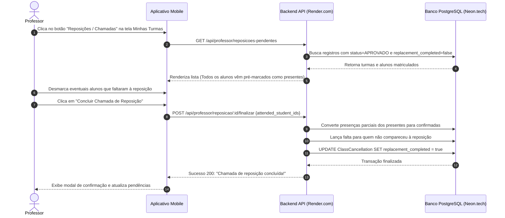

---

## 3. Fluxos do Coordenador

Mapeia a gestão administrativa da instituição: análise de semestres letivos, identificação de alunos em risco de evasão, cadastro de infraestrutura de salas, matriculação de alunos e exportação de relatórios.

### 3.1 Dashboard de Semestres & Análise de Alunos em Risco de Evasão
Permite ao coordenador visualizar a taxa geral de ausências por semestre e identificar alunos com alto índice de faltas (`< 75%` de presença).

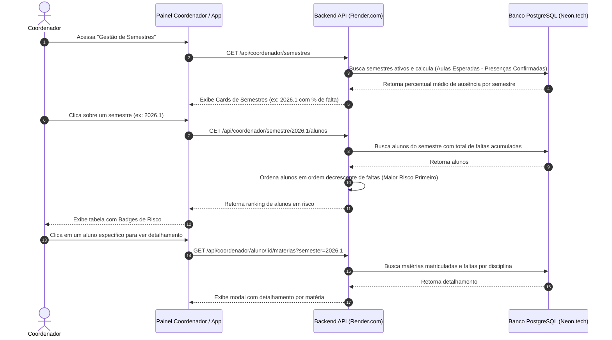

---

### 3.2 Cadastro de Infraestrutura de Salas e Turmas
Permite cadastrar novas salas físicas no campus (centróides GPS) e opcionalmente criar disciplinas vinculando-as a um professor responsável.

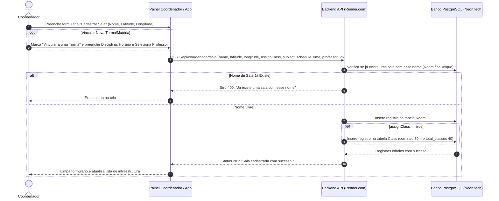

---

### 3.3 Matrícula de Alunos em Disciplinas
Permite ao coordenador vincular um aluno cadastrado no sistema a uma disciplina/turma ativa no semestre.

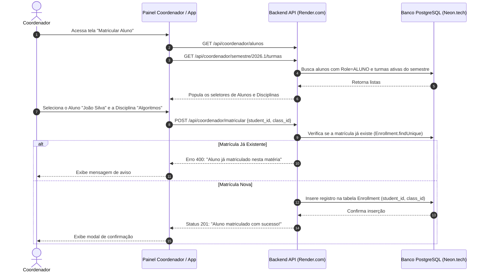

---

### 3.4 Geração e Exportação de Relatórios Gerenciais (PDF & XLSX)
Permite a extração de relatórios analíticos em formatos consolidados com suporte a gráficos e detalhamento acadêmico.

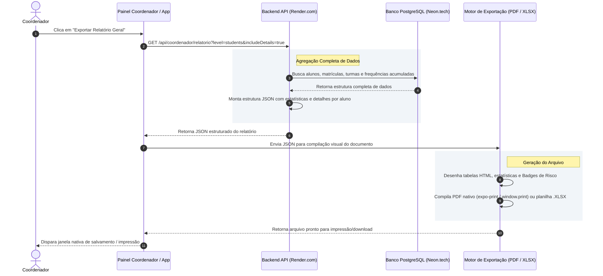

---

## 4. Fluxos de Infraestrutura & Jobs Autônomos

Mapeia as tarefas agendadas em segundo plano que garantem o funcionamento ininterrupto, a segurança e a conformidade legal do **GeoClass**.

### 4.1 Cron Job LGPD (Expurgo Diário de Geodados às 03:00 AM)
Garante a conformidade com a LGPD (*Privacy by Design*) através da anonimização de coordenadas e identificadores físicos de chamadas com mais de 6 meses.

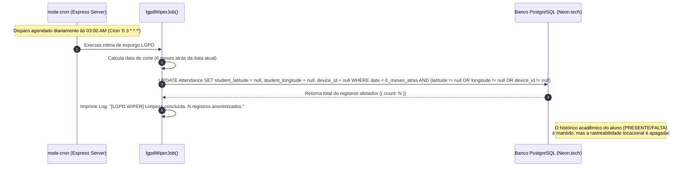

---

### 4.2 Cron Job de Notificações Automáticas (Processamento Minutual)
Varre continuamente as aulas agendadas e cria notificações proativas para os alunos.

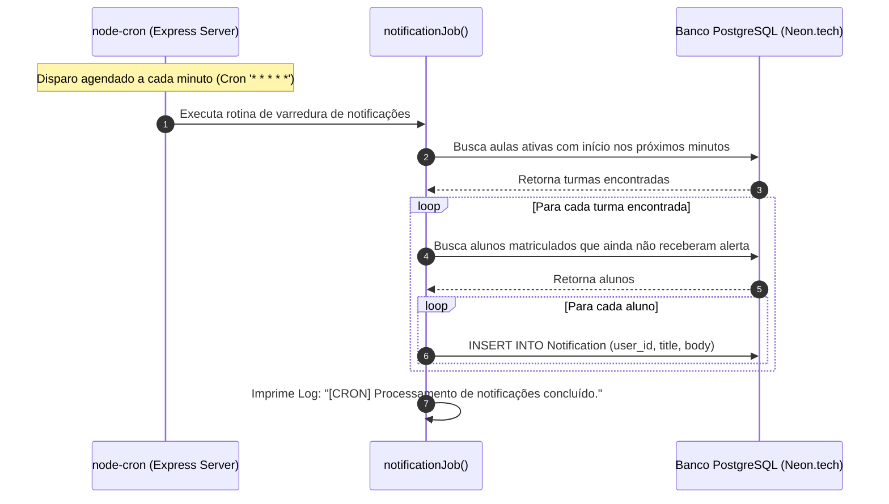

---

### 4.3 Keep-Alive Anti-Hibernação (Pinger UptimeRobot)
Impede o *spin-down* do container no plano gratuito do Render.com através de requisições HTTP periódicas.

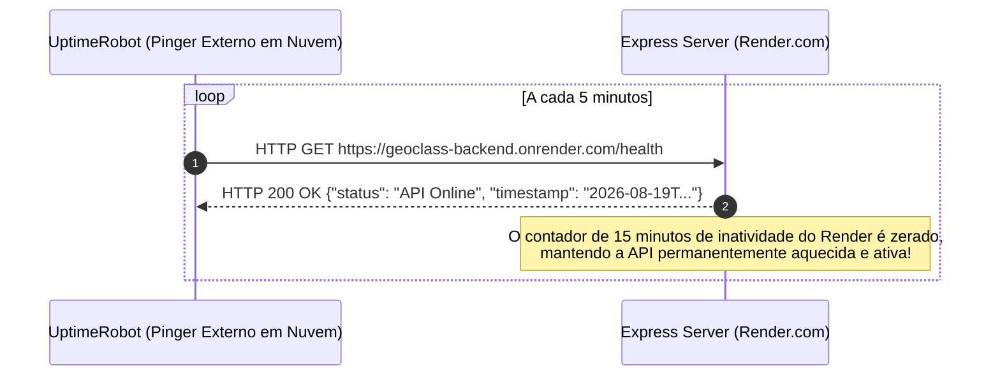

---

### 3.5 Virada de Semestre em Lote (Batch Increment) & Identificação Automática (YYYY.1/YYYY.2)
Permite ao coordenador avançar em lote o semestre letivo de todos os alunos ativos da instituição e consultar o semestre corrente detectado por calendário.

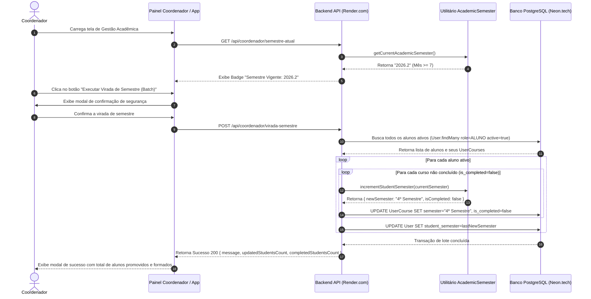

---

### 3.6 Gestão de Status Ativo (Trancamento) e Conclusão de Curso (Modo Leitura)
Permite ao coordenador desativar a conta de um aluno (trancamento) ou marcar a conclusão de um curso específico.

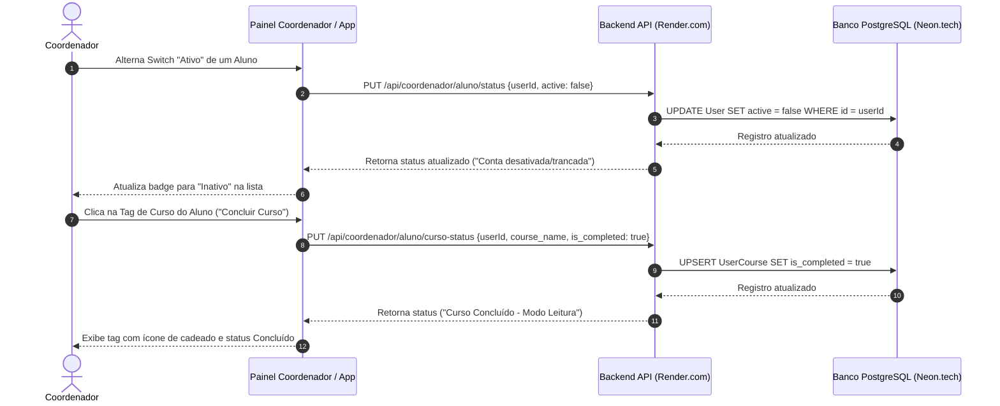

---

### 3.7 Suspensão Direta de Aulas pela Coordenação (Institucional, Curso ou Turma)
O coordenador suspende aulas administrativamente (por manutenção, recesso ou imprevisto institucional), atribuindo presença parcial automática e notificando todos os alunos e professores afetados.

```mermaid
sequenceDiagram
    autonumber
    actor Coordenador
    participant Web as Painel Coordenador / App
    participant API as Backend API (Render.com)
    participant DB as Banco PostgreSQL (Neon.tech)
    actor Alunos as Alunos Matriculados
    actor Professores as Professores

    Coordenador->>Web: Acessa "Solicitações & Cancelamentos" -> Aba "Suspender Aula"
    Web-->>Coordenador: Exibe formulário com Escopo (Toda Instituição / Por Curso / Por Turma)
    Coordenador->>Web: Seleciona o escopo, matéria/curso, data sem aula e motivo
    Coordenador->>Web: Clica em "Confirmar Suspensão & Notificar"
    Web->>API: POST /api/coordenador/cancelar-aulas {scope, date, reason_type, class_id, course_name, replacement_date}

    rect rgb(241, 245, 249)
        note right of API: Processamento em Lote Institucional
        API->>DB: Identifica turmas afetadas pelo escopo e dia da semana
        API->>DB: Cria registro(s) em ClassCancellation (status=APROVADO)
        loop Para cada turma afetada
            loop Para cada aluno matriculado
                API->>DB: UPSERT Attendance (status='PRESENCA_PARCIAL')
                API->>DB: INSERT INTO Notification (user_id=aluno, title="Aula Suspensa: [Matéria]")
            end
            API->>DB: INSERT INTO Notification (user_id=professor, title="Aula Suspensa: [Matéria]")
        end
    end

    DB-->>API: Transação concluída
    API-->>Web: Sucesso 200: "Suspensão registrada e alunos/professores notificados!"
    Web-->>Coordenador: Exibe confirmação com contador de turmas suspensas
    note over Alunos, Professores: Notificação push imediata avisando da suspensão<br/>e resguardando presença parcial até reposição
```

---

### 3.8 Análise de Solicitações de Falta & Solicitação de Atestado Médico
Painel de aprovação das ausências docentes com cobrança formal de atestado médico.

```mermaid
sequenceDiagram
    autonumber
    actor Coordenador
    participant Web as Painel Coordenador / App
    participant API as Backend API (Render.com)
    participant DB as Banco PostgreSQL (Neon.tech)
    actor Professor

    Coordenador->>Web: Acessa aba "Solicitações de Falta"
    Web->>API: GET /api/coordenador/solicitacoes-falta
    API->>DB: Busca pedidos pendentes (ClassCancellation status=PENDENTE)
    DB-->>API: Retorna lista com justificativas e links de atestado
    API-->>Web: Exibe cards de solicitações

    alt Falta por Motivo de Saúde sem Atestado
        Coordenador->>Web: Clica em "Solicitar Atestado ao Professor"
        Web->>API: PUT /api/coordenador/solicitacoes-falta/:id/pedir-atestado
        API->>DB: INSERT INTO Notification (user_id=professor, title="Solicitação de Atestado Médico")
        DB-->>API: Notificação criada
        API-->>Web: Sucesso 200: "Notificação enviada ao professor!"
        note right of Professor: Professor recebe aviso com instrução para anexar o arquivo
    else Solicitação com Atestado Válido
        Coordenador->>Web: Clica em "Aprovar Falta"
        Web->>API: PUT /api/coordenador/solicitacoes-falta/:id/aprovar
        API->>DB: UPDATE ClassCancellation SET status = 'APROVADO'
        API->>DB: Gera presença parcial (PRESENCA_PARCIAL) para todos os alunos da matéria
        API->>DB: Dispara notificações para todos os alunos da turma
        DB-->>API: Solicitação aprovada
        API-->>Web: Sucesso 200: "Falta aprovada e alunos notificados!"
        Web-->>Coordenador: Remove pedido da lista de pendências
    end
```

---

### 4.4 Disparo Automático de Alerta por Risco de Reprovação (<75% Presença)
Varre a frequência dos estudantes a cada check-in e envia notificação push automática ao atingir a faixa crítica de faltas.

```mermaid
sequenceDiagram
    autonumber
    actor Aluno
    participant API as Backend API (Render.com)
    participant DB as Banco PostgreSQL (Neon.tech)

    note over API: Processado durante o registro de presença ou job
    API->>DB: Calcula porcentagem de presença acumulada da disciplina
    DB-->>API: Retorna presenças = 28 / total_classes = 40 (70% Presença)

    alt Presença entre 70% e 74% (Faixa Crítica)
        API->>DB: INSERT INTO Notification (user_id, title, body) VALUES ("Atenção: Limite Crítico de Faltas (70% de presença em ADS)")
        DB-->>API: Notificação gravada
        note right of DB: Notificação enviada instantaneamente ao celular do aluno
    end
```

