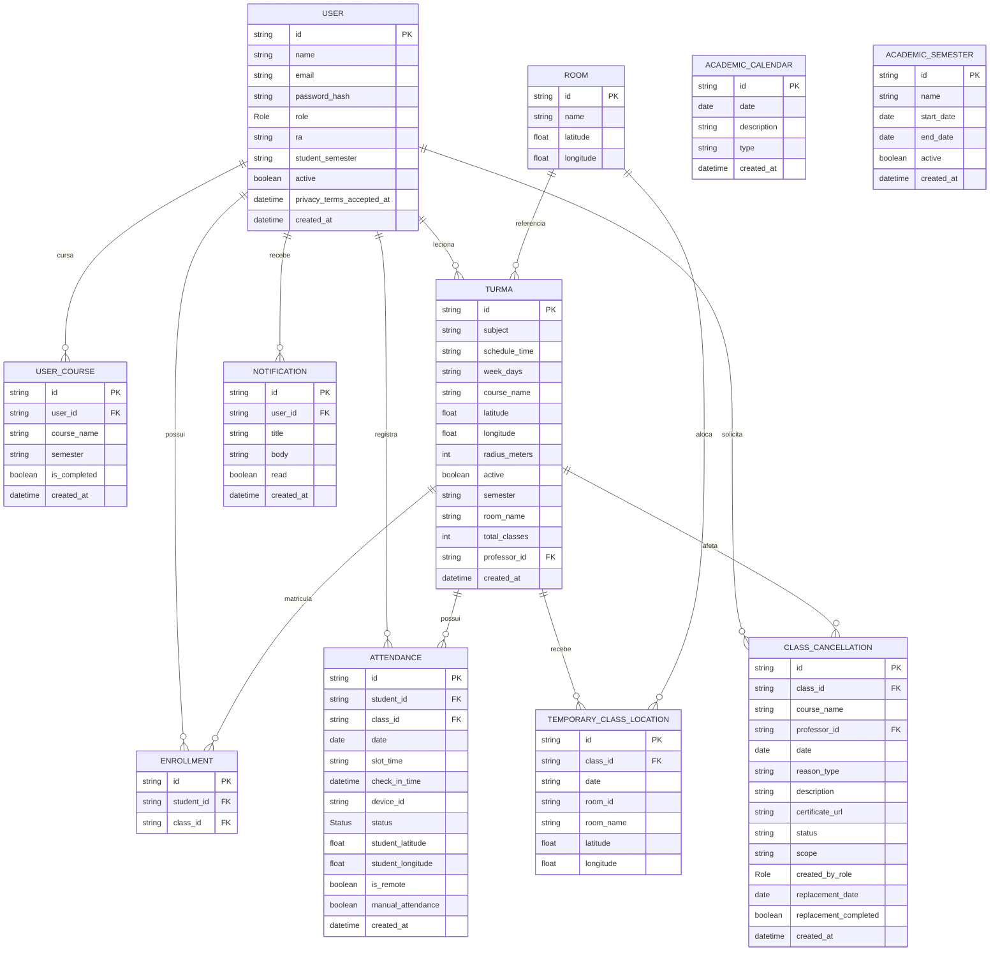

# Diagrama de Banco de Dados (MER / ERD) - GeoClass

Para a monografia/TCC, a notação **Crow's Foot (Pé de Galinha)** é o padrão utilizado na engenharia de software para mapear de forma precisa as tabelas do banco de dados relacional (PostgreSQL), os tipos de dados, chaves primárias (PK), chaves estrangeiras (FK) e a cardinalidade dos relacionamentos construídos com o **Prisma ORM**.

---

## 1. Código do Diagrama (Mermaid ERD)

---

## 2. Explicação dos Componentes do Banco de Dados (Para a Monografia)

Se a banca examinadora questionar sobre a modelagem e integridade do banco de dados, destaque os seguintes pontos arquiteturais:

1. **Polimorfismo e Status da Entidade `User`:**
   A entidade `User` gerencia todos os perfis do sistema (Alunos, Professores e Coordenadores). A diferenciação de acesso e permissões (*Role-Based Access Control*) é feita via tipo Enumerado `Role` (`ALUNO`, `PROFESSOR`, `COORDENADOR`). O atributo booleano `active` permite a desativação/trancamento temporário de contas com bloqueio de acesso ao app.

2. **Modelagem Multi-Curso & Semestre por Curso (`UserCourse`):**
   A tabela `UserCourse` permite que um aluno curse múltiplos cursos simultaneamente (ex: ADS e Gestão Empresarial) mantendo o semestre específico de cada curso (`semester`) e a sinalização de término de curso (`is_completed`). Possui a restrição composta `@@unique([user_id, course_name])`.

3. **Garantia de Unicidade e Regras N:M (`Enrollment`):**
   A relação de muitos-para-muitos entre Alunos (`User`) e Turmas (`Class`, representada como `TURMA` no diagrama para evitar colisão com a palavra reservada `class` do Mermaid) é decomposta através da entidade `Enrollment`. Para evitar matrículas duplicadas, o banco impõe a restrição composta `@@unique([student_id, class_id])`.

4. **Multi-Slot de Horários, Presença Parcial & Auditoria Antifraude (`Attendance`):**
   Para disciplinas com múltiplos blocos/horários em um mesmo dia (ex: `19:00, 19:50`), a tabela de chamadas impõe a restrição composta `@@unique([student_id, class_id, date, slot_time])`. Além dos estados tradicionais (`PRESENTE`, `ATRASADO`, `FALTA`), inclui o status **`PRESENCA_PARCIAL`**, atribuído automaticamente a todos os alunos quando uma aula é suspensa institucionalmente ou abonada por ausência do professor, resguardando o direito acadêmico até a realização da aula de reposição.

5. **Dynamic Location Override (`TemporaryClassLocation`):**
   A tabela possui a chave composta `@@unique([class_id, date])`. Quando o professor realiza a troca temporária de sala, a API efetua uma busca prioritária nesta tabela; se houver um registro ativo para a data, as coordenadas de Geofencing da sala temporária sobrepõem as coordenadas padrão da entidade `Class`.

6. **Catálogo Independente de Infraestrutura Física (`Room`):**
   A tabela `Room` funciona como um **catálogo/cadastro mestre de salas físicas e laboratórios do campus** (nome, latitude e longitude). Ela é desassociada de chaves estrangeiras rígidas em `Class` e `TemporaryClassLocation` para permitir o reuso e garantir a resiliência histórica: caso uma sala física seja removida ou alterada no catálogo, as turmas criadas e os históricos de chamadas anteriores não perdem suas coordenadas nem quebram por integridade referencial.

7. **Entidade de Comunicação Ativa (`Notification`):**
   Gerencia os alertas manuais e automáticos (incluindo avisos de troca de sala, suspensão de aulas, solicitações de atestado, agendamento de reposição e alertas de risco `< 75%`). Possui exclusão em cascata (`onDelete: Cascade`) vinculada a `User`, garantindo integridade referencial.

8. **Privacy by Design & Compliance LGPD:**
   A entidade `User` registra o timestamp do consentimento expresso em `privacy_terms_accepted_at`. Além disso, os atributos sensíveis `student_latitude`, `student_longitude` e `device_id` na tabela `Attendance` são anuláveis (`nullable`), permitindo que a rotina automatizada `LgpdWiperJob` limpe esses geodados de presenças com mais de 6 meses sem deletar o registro histórico acadêmico do aluno.

9. **Gestão de Cancelamentos, Atestados e Reposições (`ClassCancellation`):**
   Estrutura unificada que gerencia tanto a solicitação de ausência feita pelo docente quanto a suspensão direta de aulas pela coordenação (em escopos `TURMA`, `CURSO` ou `INSTITUICAO`). Suporta anexação de atestados médicos (`certificate_url`), controle de aprovação (`status`), vinculação com data futura de reposição (`replacement_date`) e flag de conclusão (`replacement_completed`), notificando alunos e docentes em cada transição de estado.

10. **Calendário Acadêmico e Períodos Letivos (`AcademicCalendar` e `AcademicSemester`):**
    A tabela `AcademicSemester` delimita os períodos oficiais da instituição (ex: `2026.1`, `2026.2` com `start_date` e `end_date`), permitindo que o sistema identifique dinamicamente o semestre corrente e execute viradas de semestre em lote. Já a tabela `AcademicCalendar` cadastra feriados, recessos e eventos não letivos garantindo que o sistema não compute ausências indevidas.

